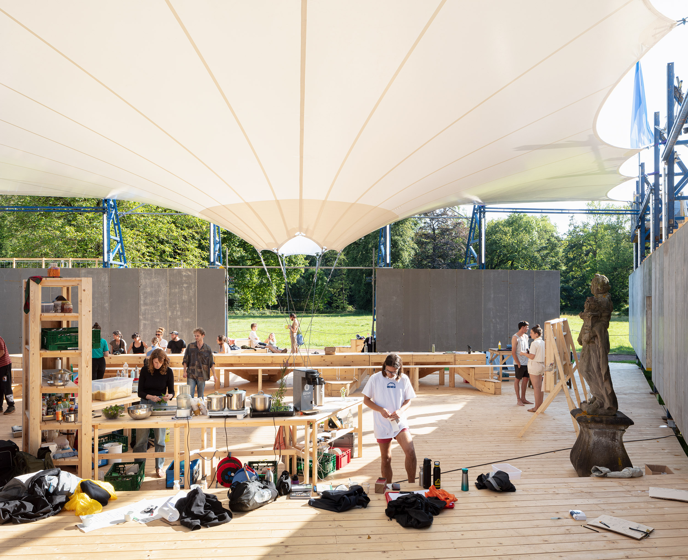
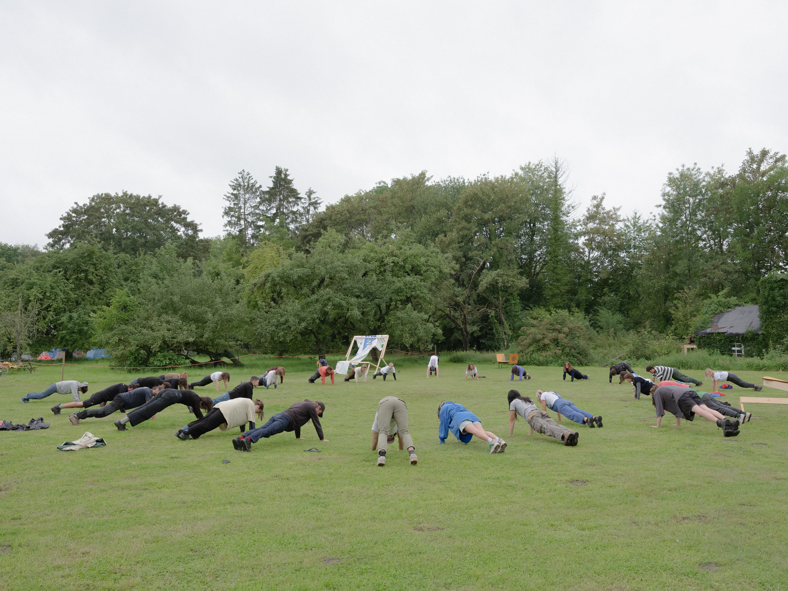
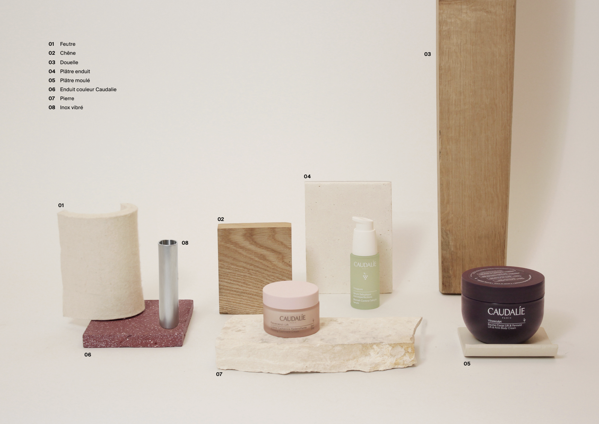
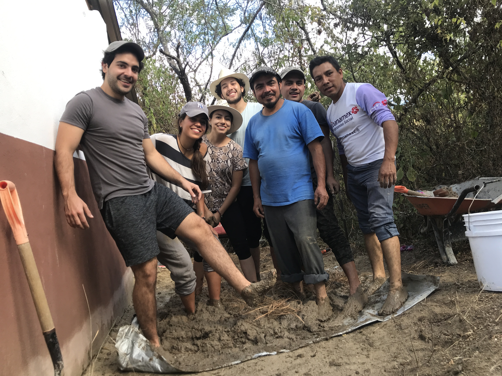

## [Other](page24.md)

_A few things that shaped how I work, but didn't come from a client brief._

### [Last Resort: Construction festival by Constructlab (Belgium, 2023)](page25.md)
> 
> 

### [Commercial work (Paris, 2022)](page14.md)
> 

### [Foro/ENTRE/2020 (Puebla, 2020)](https://issuu.com/escuadraarquitectura/docs/foro_entre_book)

> <iframe width="300" height="205" src="https://www.youtube.com/embed/arjBXFOUYG4?si=Z6kUlvtheehR28nj" title="YouTube video player" frameborder="0" allow="accelerometer; autoplay; clipboard-write; encrypted-media; gyroscope; picture-in-picture; web-share" referrerpolicy="strict-origin-when-cross-origin" allowfullscreen></iframe> 

### [Eco-Tequio (community build, Oaxaca, 2020)](page11.md)
> 

### [Digital prototyping & analogue fabrication (graduation project, 2020)](page9.md)

> 

### [Artworks (2010-present)](page13.md)

[back](./)
