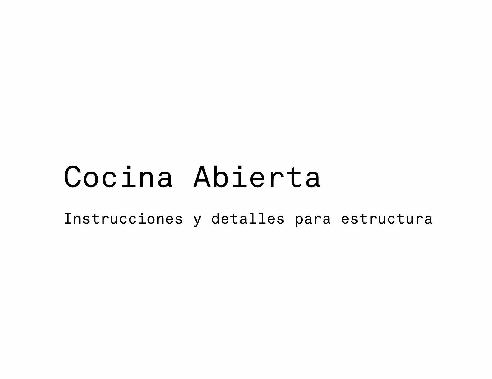

### Woodworking, Digital Design, & Community Engagement
#### Taller Casa-Estudio 
##### Project led by Luis Gil & Nuria Benítez

###### See also: [Woodworking, Digital Design, & Community Engagement)](page18.md)

The project at hand was realized in Reserva Peñitas, Valle de Bravo. It was developed with digital design tools on one side, unskilled labor and limited construction literacy on the other.

Working within a parametric design framework, the project developed an iterative digital definition that allowed multiple structural and aesthetic configurations to be evaluated against feasibility constraints and presented directly to the client. The definition functioned as a shared decision-making tool.

###### Manual

[back](./)
