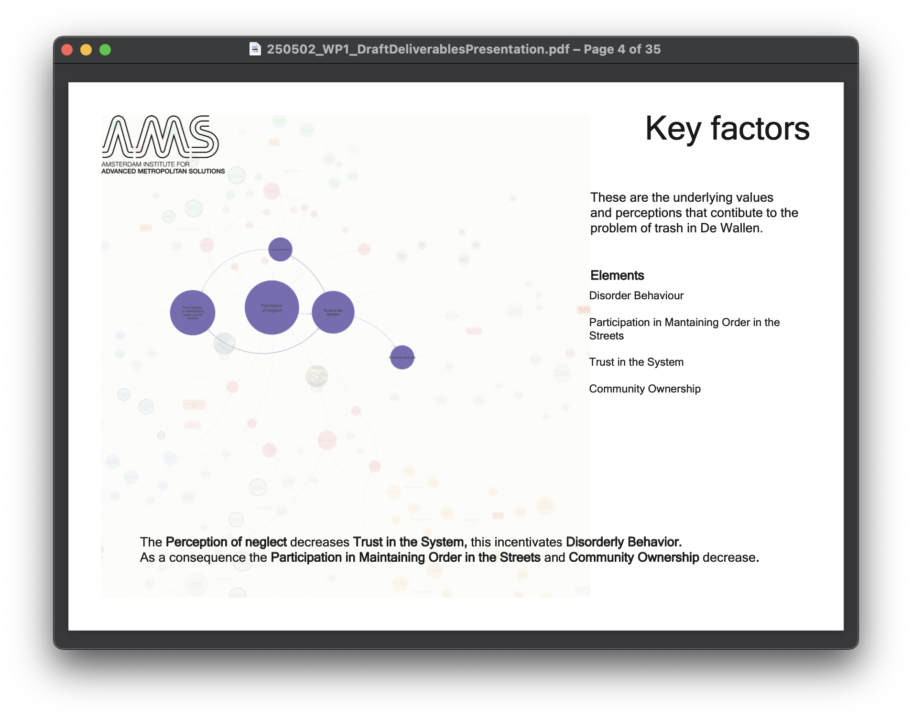
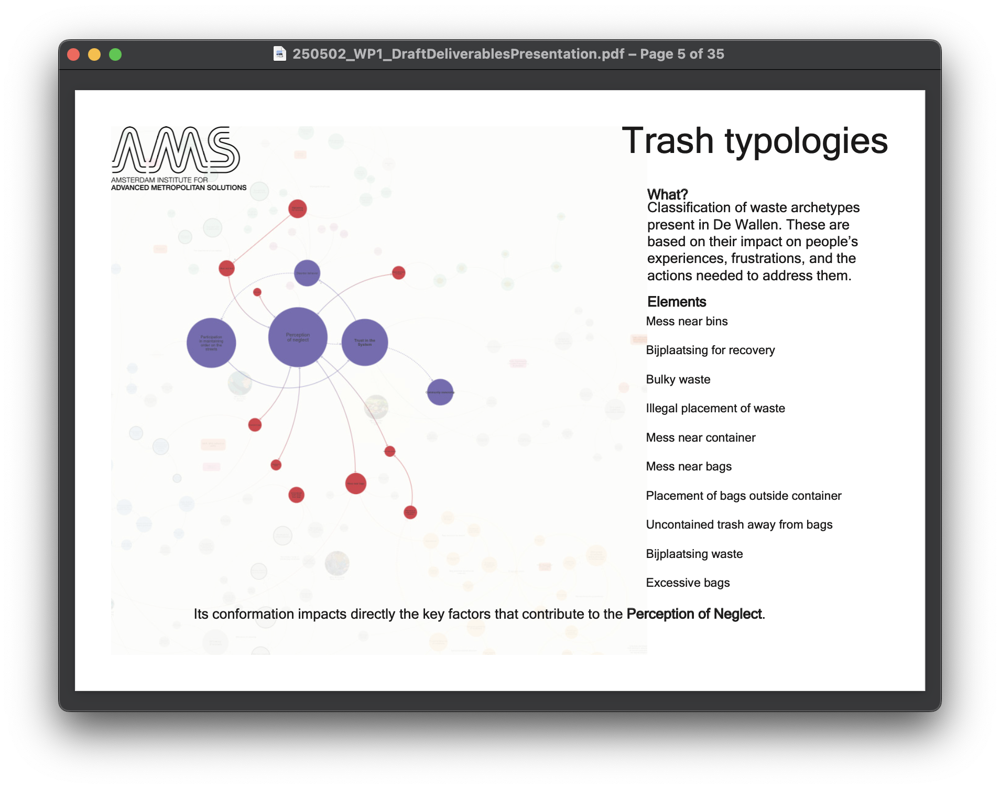
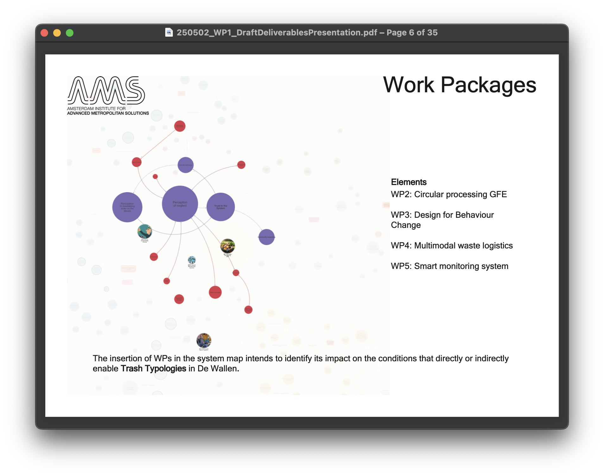
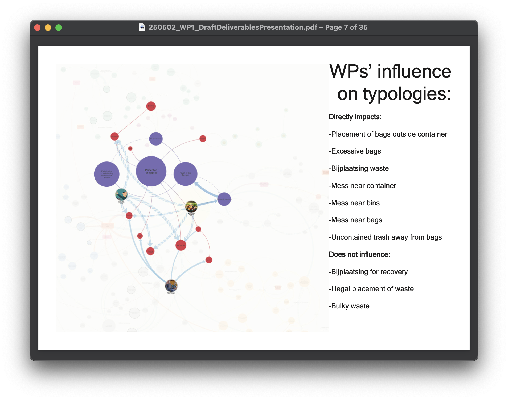
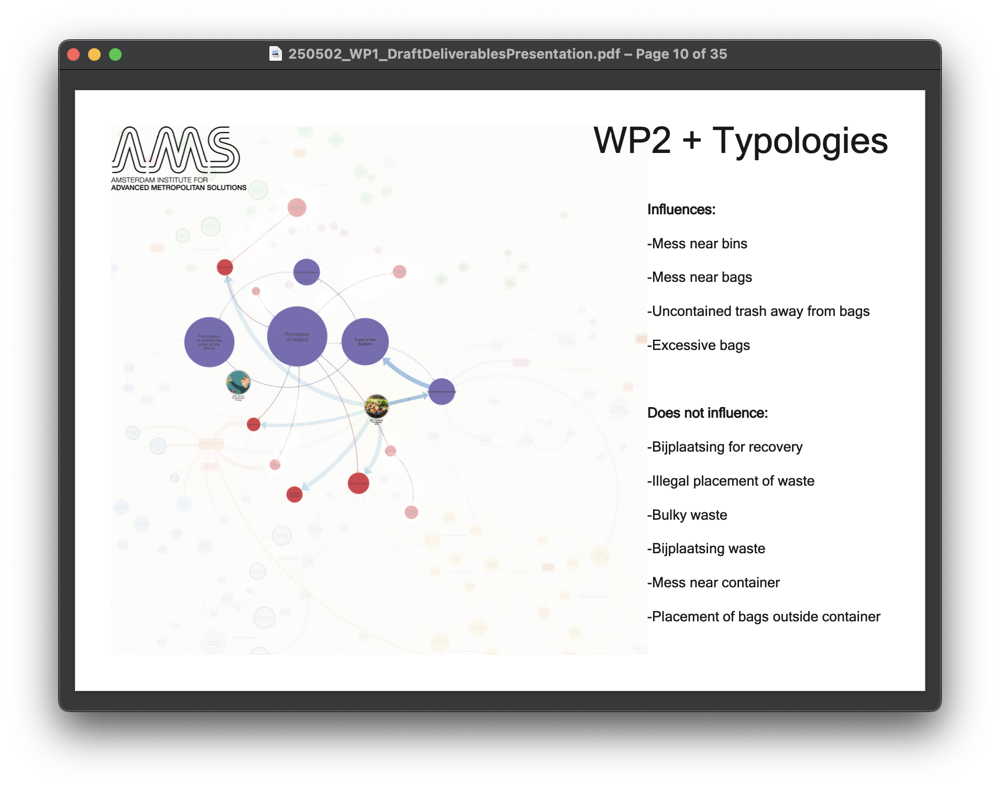
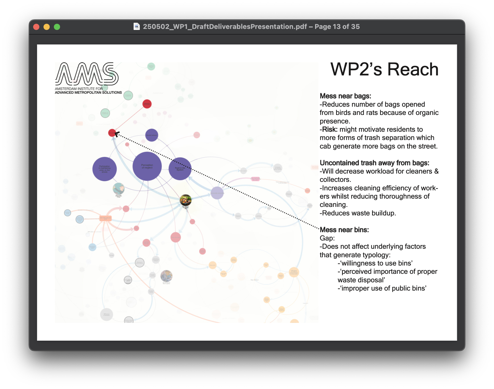
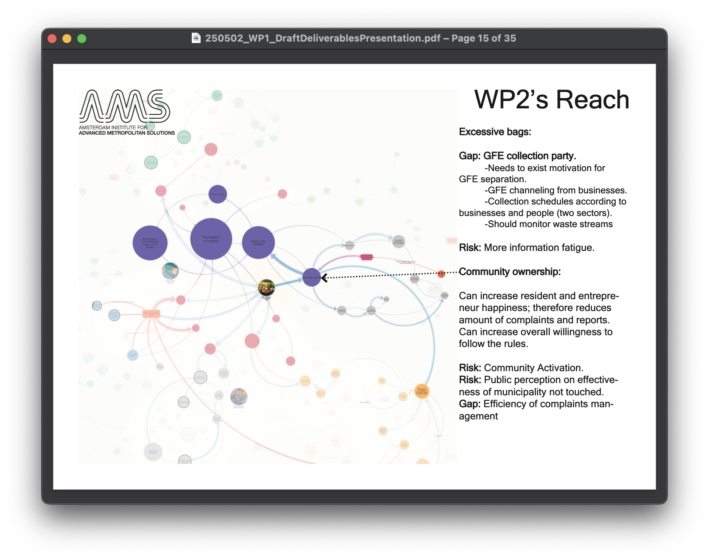

### The messy middle of a living lab
#### Gap and risk analysis testing research proposals against street waste typologies 
##### Schone Binnenstad Living Lab

###### See also: [Clean Inner City Living Lab)](page-1.md)(the system map this analysis was built on)

Each WP was placed inside the system map to trace which typologies it could influence, directly or indirectly. Seven of the ten typologies were within reach of at least one work package. Three were outside all of them: bulky waste, illegal placement of waste, and bags left out for informal recovery. For each work package (WP) the analysis followed its impact through the map and named what it would leave unsolved and what it could make worse.

A stakeholder analysis sorted the actors around each pilot into four roles: those who enable the experiment, those who grant permission, those whose involvement magnifies the impact, and those whose daily work it disrupts. It also surfaced overlaps between pilots, for example catering businesses joining one pilot could become partners in another.

The gap analysis was discussed with the work package researchers, the project manager and the programme developer, and became the reference for revising the scope of the research proposals and widening the project’s attention to governance.

###### Key factors and trash typologies

###### WPs and their influence on typologies

###### WP2 impact overview

###### WP2 specifics

[back](./)

